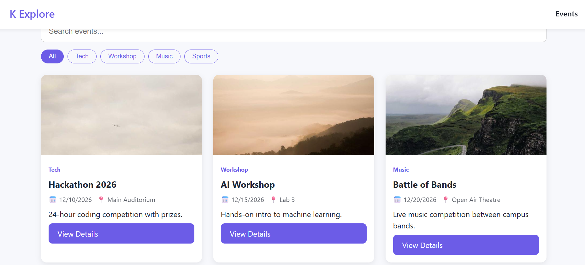

# K Explore – Event Management Website

A responsive event management website where users can explore upcoming events, search and filter them, view details, and register.

🔗 **Live Demo:** https://25057045-sys.github.io/k-explore/

📁 **Repository:** https://github.com/25057045-sys/k-explore

## Features
- Responsive layout (mobile, tablet, desktop)
- Hero section and event cards (name, date, venue, image, description)
- Live search and category filter
- Event details page with countdown timer
- Registration form with JavaScript validation and confirmation message
- Dark / light mode with saved preference
- Registrations stored in Local Storage (duplicate registration check)

## Tech Stack
HTML5, CSS3, JavaScript (vanilla), Git & GitHub

## Project Structure
k-explore/
├── index.html
├── event.html
├── css/ (style.css, theme.css, responsive.css)
├── js/ (data.js, main.js, event.js, validation.js, storage.js, theme.js)
└── assets/

## How It Works
- `data.js` holds the events array; `main.js` renders cards and handles search and filters.
- `event.html?id=N` loads an event using the URL parameter; `event.js` fills the page and runs the countdown.
- `validation.js` validates name, email, and phone before saving through `storage.js`.
- `theme.js` toggles dark/light mode using CSS variables.

## Run Locally
1. Clone: `git clone https://github.com/25057045-sys/k-explore.git`
2. Open the folder in VS Code
3. Run with the Live Server extension (or open `index.html`)

## Screenshots

## Author
Priyanshu Das